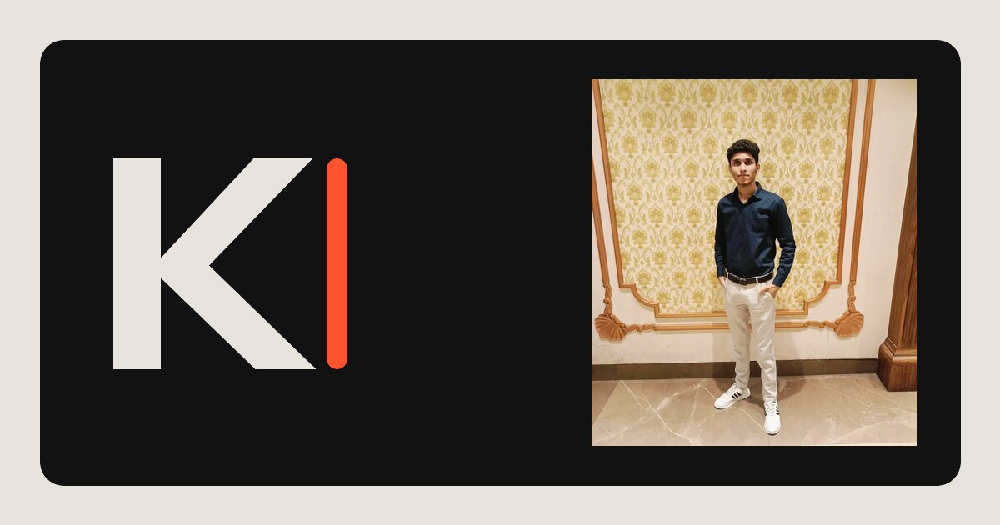

# Keshav Anand — Developer Portfolio

A fast, responsive personal portfolio for **Keshav Anand** — BCA graduate (2022–2025), aspiring software developer, and UI designer. Built with React 19, TypeScript, Vite, React Router, Framer Motion, and Lenis.

[](https://my-portfolio-keshav529.vercel.app)
[](https://react.dev)
[](https://www.typescriptlang.org)
[](https://vite.dev)
[](https://nodejs.org)



---

## Table of Contents

- [Overview](#overview)
- [Tech Stack](#tech-stack)
- [Quick Start](#quick-start)
- [Scripts](#scripts)
- [Routes](#routes)
- [Project Structure](#project-structure)
- [Environment Variables](#environment-variables)
- [Editing Content](#editing-content)
- [Editable Design Tokens](#editable-design-tokens)
- [Image Assets & Social Card](#image-assets--social-card)
- [Accessibility & Performance](#accessibility--performance)
- [Deployment](#deployment)
- [Contact](#contact)

---

## Overview

A hand-built, editorial-style portfolio with a warm cream/orange identity. It covers the full story — home, about, process, project case studies, contact, and resources — with real project links rather than invented metrics.

**Highlights**

- **Six routes plus a per-project detail page**, all client-side routed with animated transitions.
- **Motion with intent** — intro counter loader, 50/50 fullscreen menu, dual-panel page transitions, and Lenis inertial scrolling.
- **`prefers-reduced-motion` aware** — animation is gated through Framer Motion's `MotionConfig`, and Lenis is bypassed entirely.
- **Light/dark theme** with no flash of the wrong theme (inline bootstrap script in `index.html`).
- **Per-route SEO** — dynamic title, description, canonical, Open Graph, and Twitter tags via `RouteMeta`, plus `Person` JSON-LD on the base page.
- **Contact form** delivered through Formspree, configured by environment variable.
- **Graceful image strategy** — every optional photo falls back to an on-brand SVG illustration instead of a broken image.
- **Route-level code splitting** and vendor chunk splitting (`react`, `router`, `motion`, `lenis`, `icons`).
- **Accessibility baseline** — skip link, semantic landmarks, visible focus states, keyboard-navigable menu, and labeled controls.

---

## Tech Stack

| Layer | Choice |
| --- | --- |
| Framework | React 19 |
| Language | TypeScript 5.8 (`tsc --noEmit` for type checking) |
| Build tool | Vite 6 |
| Routing | React Router 7 |
| Animation | Framer Motion 12 |
| Smooth scrolling | Lenis 1.3 |
| Icons | Lucide React |
| Styling | Hand-written CSS with custom properties (design tokens) |
| Forms | Formspree |
| Hosting | Vercel |

---

## Quick Start

**Prerequisites**

- **Node.js 22.x** (enforced by `engines.node` in `package.json`)
- npm (bundled with Node) — a `bun.lock` is also committed if you prefer `bun install`

```bash
# 1. Clone
git clone https://github.com/keshav529/My_Portfolio.git
cd My_Portfolio

# 2. Install dependencies
npm install

# 3. Optional but recommended: add local env config
cp .env.example .env      # Windows PowerShell: Copy-Item .env.example .env

# 4. Start the dev server
npm run dev
```

Open **http://localhost:3000**. The dev server binds to `0.0.0.0`, so you can also test on your phone over the local network.

> In development the console prints a `[Dev Notice]` group listing optional image assets that are missing and falling back to SVG illustrations. This is expected and harmless.

---

## Scripts

| Command | What it does |
| --- | --- |
| `npm run dev` | Start the Vite dev server on `0.0.0.0:3000` with HMR |
| `npm run build` | Production build into `dist/`, copying `image/` assets and syncing the site URL |
| `npm run preview` | Serve the built `dist/` output on port `3000` |
| `npm run lint` | Run `tsc --noEmit` — the project's type check |

Run `npm run lint` and `npm run build` before pushing; both should pass.

---

## Routes

| Route | Page | Notes |
| --- | --- | --- |
| `/` | Home | Hero, services, featured work, FAQ, CTA |
| `/about` | About | Journey timeline, education, skills, learning stack |
| `/process` | Process | Four steps: Understand → Plan → Build → Improve |
| `/work` | Work | Project index with category filtering |
| `/work/:slug` | Project detail | Case study, live demo, and repo links |
| `/contact` | Contact | Formspree-backed form plus direct contact details |
| `/resources` | Resources | Resume PDF, GitHub, LeetCode, LinkedIn |
| `*` | Not found | Friendly 404 with a route back home |

Project slugs: `currency-converter`, `netflix-clone`, `website-clone`, `tic-tac-toe`, `stopwatch`, `calculator`.

`vercel.json` rewrites unknown non-asset paths to `/index.html`, so these routes also work on a hard refresh in production.

---

## Project Structure

```
.
├── image/                     # Source assets (WebP + resume PDF), copied to dist/image at build
├── public/                    # Served as-is: favicons, og-share card, sitemap, robots, manifest
├── src/
│   ├── components/            # Navbar, Footer, Hero, ImageSlot, RouteMeta, transitions, tabs
│   ├── data/portfolioData.ts  # Single source of truth for all content
│   ├── hooks/                 # Shared React hooks
│   ├── pages/                 # Home, About, Process, Work, ProjectDetail, Contact, Resources, 404
│   ├── styles/
│   │   ├── tokens.css         # Colours, fonts, radii, type scale, breakpoints
│   │   └── global.css         # Layout and component styles
│   ├── App.tsx                # Router shell, providers, lazy routes
│   ├── main.tsx               # Entry point
│   └── vite-env.d.ts          # Typed import.meta.env
├── index.html                 # Base SEO meta, JSON-LD, fonts, theme bootstrap
├── vite.config.js             # Chunk splitting, asset copy, site URL sync
├── vercel.json                # SPA rewrites, cache headers, legacy redirect
├── DEPLOY.md                  # Step-by-step Vercel deployment guide
└── PROJECT_BRIEF.md           # Design and content brief
```

---

## Environment Variables

Copy `.env.example` to `.env` for local development. All variables are optional at build time because the code falls back to a working default — but `VITE_FORMSPREE_ID` must be set for the contact form to deliver real messages.

| Variable | Required | Default | Purpose |
| --- | --- | --- | --- |
| `VITE_SITE_URL` | Optional | `https://my-portfolio-keshav529.vercel.app` | Canonical URL. Set only if you switch to a custom domain; the build rewrites `index.html`, `sitemap.xml`, and `robots.txt` to match. |
| `VITE_FORMSPREE_ID` | Yes, for live form | `xnpddnez` | Formspree form ID — the code at the end of `https://formspree.io/f/YOUR_ID`. |

> Vite inlines `VITE_*` variables at **build time**. Changing one on Vercel requires a redeploy — see [DEPLOY.md](DEPLOY.md).

---

## Editing Content

Nearly all copy lives in one file:

**`src/data/portfolioData.ts`** — profile, tagline, contact details, social links, services, project case studies, skills and skill groups, education timeline, journey stops, process steps, FAQ, and resources.

It exports typed objects (`PROFILE`, `PROJECTS`, `SERVICES`, `SKILL_GROUPS`, `EDUCATION_TIMELINE`, `ABOUT_TIMELINE`, `PROCESS_STEPS`, `RESOURCE_ITEMS`, …) with interfaces above each one. Adding a project means appending an object with a unique `slug`, the correct `image` path and dimensions, plus `liveUrl` / `githubUrl` and the `hasLiveDemo` / `hasExactRepo` flags.

Other places you may need to touch:

- `src/components/RouteMeta.tsx` — per-route title, description, and canonical metadata
- `index.html` — base metadata, JSON-LD structured data, theme bootstrap, font loading
- `public/sitemap.xml` and `public/robots.txt` — crawl hints

---

## Editable Design Tokens

| File | Contains |
| --- | --- |
| `src/styles/tokens.css` | Colours, fonts, radii, type scale, breakpoints, motion durations |
| `src/styles/global.css` | Layout, component styles, responsive rules |
| `src/components/ImageSlot.tsx` | Unified image slot: placeholder, tint overlay, aspect ratio, fallback |
| `src/components/BrandIllustration.tsx` | On-brand fallback SVG illustrations |

---

## Image Assets & Social Card

Images use a single `<ImageSlot />` component: it shows a warm placeholder while loading, applies an editorial cream/orange tint that fades on hover, and falls back to an on-brand SVG illustration when an optional `.webp` file is absent.

Add new WebP files to the project-root **`image/`** folder. The build copies `.webp` files and `Keshav-Anand-Resume.pdf` into `dist/image/`, so they resolve at `/image/...` in production. (Only those are copied — `.png`/`.jpg` originals stay in the repo as sources.)

| File Path | Aspect Ratio | Recommended Size | Max Weight | Used In |
| --- | --- | --- | --- | --- |
| `image/resume-preview.webp` | `3:4` | `600x800` | `< 150 KB` | Resume banner (Home & Resources) |
| `image/journey-college.webp` | `16:10` | `800x500` | `< 150 KB` | About timeline (stop 3) |
| `image/journey-desk.webp` | `3:4` | `720x960` | `< 150 KB` | About timeline (stop 6), process page |
| `image/<slug>-mobile.webp` | `1:1` | `600x600` | `< 150 KB` | Project detail mobile slot |
| `image/<slug>-detail.webp` | `1:1` | `600x600` | `< 150 KB` | Project detail state slot |

All entries are optional; a missing file degrades to an illustration rather than a broken image.

### Social Share Card (`public/og-share.jpg`)

LinkedIn, X, WhatsApp, and Discord need a raster `.jpg`/`.png` for `og:image`. `index.html` and `src/components/RouteMeta.tsx` already point at `/og-share.jpg`; `public/og-share.svg` is the editable 1200×630 source.

1. Open `public/og-share.svg` in Figma, Inkscape, or Chrome.
2. Export at `1x` (`1200x630`) to `public/og-share.jpg`, quality ~85, under 150 KB.
3. Bump the cache-busting query string if social platforms cached the old card.

---

## Accessibility & Performance

- Skip-to-content link, semantic landmarks, and a logical heading order.
- Custom menu and tabs implemented with keyboard support, `aria-*` state, and Escape handling.
- Motion respects `prefers-reduced-motion`; Lenis is bypassed entirely in that mode.
- Contrast-checked light and dark palettes driven by CSS custom properties.
- Route-level `lazy()` splitting and manual vendor chunks keep the initial bundle small.
- `vercel.json` sets immutable long-term caching for `/assets/*` and 30-day caching with `stale-while-revalidate` for `/image/*`.

---

## Deployment

The site is live at **[my-portfolio-keshav529.vercel.app](https://my-portfolio-keshav529.vercel.app)** and deploys automatically from `main` via Vercel.

**Short version**

1. Push the repo to GitHub.
2. Import it at [vercel.com/new](https://vercel.com/new) with framework preset **Vite**, build command `npm run build`, output directory `dist`.
3. Add `VITE_FORMSPREE_ID` (and optionally `VITE_SITE_URL`) under **Project Settings → Environment Variables**.
4. Deploy.

`vercel.json` handles SPA rewrites for `/work/:slug`, `/about`, and friends, long-term asset caching, and a permanent redirect from the old resume path `/image/keshav_CV.pdf.pdf` to `/image/Keshav-Anand-Resume.pdf`.

Full walkthrough, verification checklist, and redeploy notes: **[DEPLOY.md](DEPLOY.md)**.

---

## Contact

- **Email** — [keshavanand748@gmail.com](mailto:keshavanand748@gmail.com)
- **LinkedIn** — [keshav-anand-8ba87a293](https://www.linkedin.com/in/keshav-anand-8ba87a293)
- **GitHub** — [@keshav529](https://github.com/keshav529)
- **LeetCode** — [@keshavanand](https://leetcode.com/u/keshavanand/)

Open to web development internships, trainee roles, and junior front-end opportunities.

---

<sub>Personal portfolio project. The code, content, and imagery are not licensed for reuse without permission.</sub>
